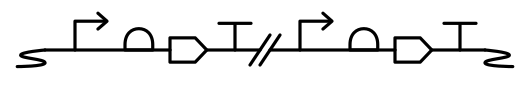

# SEP V026: Introduction of double slash as an alternative Glyph for Omitted Detail

| SEP | |
| --- | --- |
| **Title** | Introduction of double slash as an alternative Glyph for Omitted Detail |
| **Authors** | Felipe Buson (fxbuson@gmail.com), Georgie Hau Sorensen, Lukas Buecherl |
| **Editor** | Prashant Vaidyanathan (vprashant1@gmail.com) |
| **Type** | Specification |
| **SBOL Visual Version** | |
| **Status** | Draft |
| **Created** | 26 Feb 2026 |
| **Last modified** |  09 Nov 2026 |
| **Issue** | |

## Abstract

This proposal introduces a new SBOL Visual glyph, represented by diagonal double slashes, to denote generic breaks in DNA. These breaks include regions where sequence continuity is intentionally unspecified, undefined, interrupted, or skipped for schematic clarity. The use of double slash aligns with widespread conventions in biological schematics and provides a simple, intuitive, and compact symbol to improve readability. 

## Table of Contents  <remove TOC if SEP is rather short>

- [1. Rationale](#rationale) 
- [2. Specification](#specification)
- [3. Example or Use Case](#example)
- [4. Backwards Compatibility](#compatibility)
- [5. Discussion](#discussion)
- [Copyright](#copyright)

## 1. Rationale 

1.1. Widespread Use

The double slash mark is traditionally used in biological schematics to indicate:

- “region removed/not drawn”
- “break in continuity”
- “shift in sequence”  

This convention is common in textbooks, research illustrations, and even circuit diagrams in other fields, and has been adopted more widely than the current Omitted Detail glyph currently in SBOL Visual. 

The familiarity of this symbol lowers the cognitive load for new users, and it makes diagrams more immediately interpretable.

1.2. Glyph Simplicity

The double slash glyph:

- Is visually compact
- Is sufficiently distinct from existing SBOL Visual glyphs
- Can be rendered easily in both digital and hand-drawn form
- Maintains clarity even at small scale

  

## 2. Specification 

### Omitted Detail

The Omitted Detail glyph is a break in the backbone with an ellipsis to indicate that material would normally be in that location:

Alternately, Omitted Detail may be represented with a slanted double slash breaking the backbone line:

In this case, the slash lines MUST be slanted in order to differentiate this glyph with Blunt Restriction Site.

## 3. Example or Use case :

Here, the diagram represents two genes in distinct loci in the genome, separated by omitted genomic context,represented by the proposed glyph.

## 4. Backwards Compatibility 

This SEP is backward compatible insofar as it doesn't directly introduces conflicts with existing glyphs. As mentioned in the dicussion section below, there is some similarity to Blunt Restriction Site, if the diagonal slashes are not drawn with enough of an angle.

## 5. Discussion 

This proposition was raised in the review the community did for the "[A Decade of SBOL Visual](https://pubs.acs.org/doi/10.1021/acssynbio.5c00417)" article, over multiple HARMONY and COMBINE conferences. We noted the glyph was preferred over other options to represent long omissions on genetic diagrams.

It was also noted that this glyph was already proposed on [SEP_V003](SEP_V003.md) as Omitted Detail, but was avoided for possible confusion with Blunt Restriction Site.

Editors now reconsidered adding this glyph as an alternative and the possible confusion was brought up again, so an explicit warning about the angle of the diagonal slashes should be included.

## Copyright 

  
   
  To the extent possible under law,
  <a rel="dct:publisher"
     href="sbolstandard.org">
    SBOL developers</a>
  has waived all copyright and related or neighboring rights to
  SEP V026.
This work is published from:

  United States.

